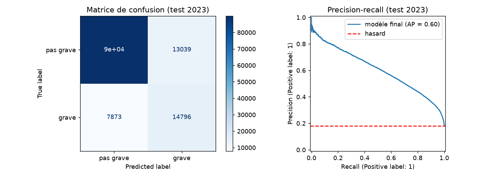
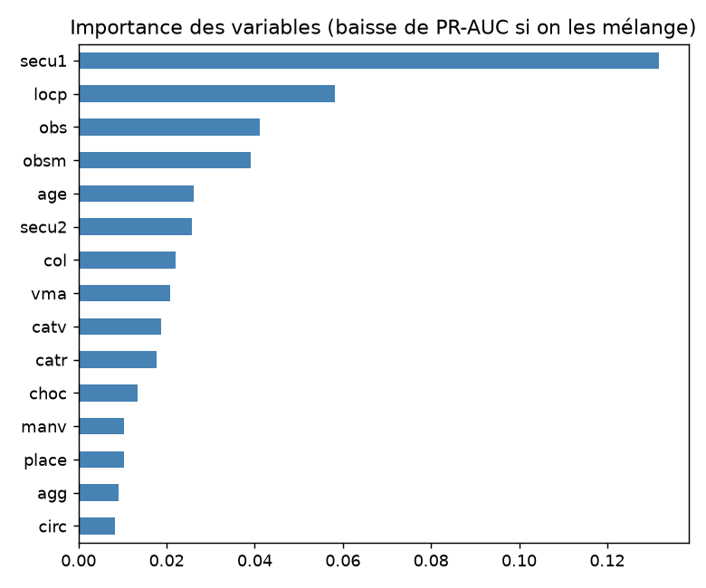

# Pipeline de données : gravité des accidents de la route (BAAC 2019-2023)

Pipeline de données de bout en bout, de l'ouverture des données publiques jusqu'à un modèle de machine learning et une application web, avec **Python, PostgreSQL, dbt, Docker et Streamlit**.

Ce projet est la version industrialisée de mon [notebook de data science](https://github.com/Gaya-014/projet-accidents-routiers) sur les mêmes données : le notebook montre la démarche de modélisation, ce dépôt montre comment amener les données jusqu'au modèle de façon reproductible et testée.

## Architecture

```
data.gouv.fr (CSV BAAC)
        │  ingestion/ingerer.py  (Python, psycopg COPY)
        ▼
PostgreSQL ── schéma raw        données brutes, en texte, telles quelles
        │  dbt (SQL)
        ▼
         ── schéma staging      vues de nettoyage (-1, virgules, types) + 1 lieu par accident
         ── schéma marts        table accidents_usagers : 1 ligne par personne, 619 552 lignes
        │  app/entrainer.py  (scikit-learn)
        ▼
modèle + métriques (dossier modele/)  ──►  application Streamlit
```

Tout tourne dans des conteneurs Docker (`docker-compose.yml`) : base PostgreSQL, Adminer (visualiser la base), ingestion, dbt, entraînement, application.

## Les données

Fichiers annuels des accidents corporels de la circulation (ONISR, data.gouv.fr), 2019 à 2023 : caractéristiques, lieux, véhicules, usagers.

| Année | Personnes | Taux de graves |
|---|---|---|
| 2019 | 132 977 | 0,183 |
| 2020 | 105 295 | 0,186 |
| 2021 | 129 188 | 0,173 |
| 2022 | 126 421 | 0,180 |
| 2023 | 125 671 | 0,180 |

Cible : **grave** = personne tuée ou hospitalisée (environ 18 % des cas).

## Transformations dbt

- 4 modèles `staging` (un par fichier) : normalisation des `-1` et ` -1` en valeurs manquantes, virgules décimales, conversion des types via des macros Jinja.
- 1 modèle `intermediate` : un seul lieu par accident (le fichier lieux a plusieurs lignes par accident en 2023). Hypothèse : on garde la ligne à la vitesse autorisée la plus élevée.
- 1 modèle `marts` : table finale, une ligne par personne, avec l'âge, l'heure, le jour de la semaine, etc.
- **23 tests automatiques**, tous au vert : clés non nulles et uniques, relations entre tables, valeurs acceptées, et 4 tests SQL personnalisés (une ligne par véhicule, aucune personne perdue ou dupliquée par les jointures, valeurs plausibles, taux de graves réaliste).

## Modèle et évaluation dans le temps

| Étape | Années |
|---|---|
| Apprentissage | 2019, 2020, 2021 |
| Validation (choix du seuil de décision) | 2022 |
| Modèle final réentraîné sur | 2019 à 2022 |
| **Test (évalué une seule fois)** | **2023** |

Modèle : `HistGradientBoostingClassifier` (`class_weight='balanced'`) dans un pipeline scikit-learn (imputation, standardisation, one-hot). Seuil de décision choisi sur la validation pour maximiser le F1 : 0,67.

Résultats sur le test 2023 (125 671 personnes, dont 22 669 graves) :

| Mesure | Valeur |
|---|---|
| PR-AUC | 0,605 (0,180 pour le hasard) |
| ROC-AUC | 0,871 |
| Recall (graves) | 0,653 : 14 796 graves trouvés sur 22 669 |
| Precision (graves) | 0,532 : environ une alerte sur deux est fausse |
| F1 (graves) | 0,586 |
| Accuracy | 0,834 (0,820 pour un modèle qui répond toujours « pas grave ») |

La PR-AUC est quasi identique sur la validation (0,609) et sur le test (0,605) : le modèle est stable d'une année à l'autre. L'accuracy est trompeuse à cause du déséquilibre, donc l'évaluation s'appuie sur la PR-AUC, le recall, la precision et le F1.




## Limites

- Plusieurs variables (obstacle heurté, point de choc, manœuvre, type de collision) ne sont connues qu'**après** l'accident : le modèle explique la gravité d'accidents déjà arrivés, il ne prévoit pas le risque avant.
- L'équipement de sécurité (`secu1`) domine l'importance des variables. Les valeurs « non renseigné » sont presque jamais graves : cela peut refléter la façon dont les fiches sont remplies autant qu'un effet réel.
- La variable `locp` (position du piéton) n'est renseignée que pour les piétons : elle joue en partie le rôle d'un indicateur « c'est un piéton ».
- Les hyperparamètres viennent de la recherche faite dans le notebook ; ils ne sont pas re-réglés dans le pipeline.
- Le label regroupe « tué » et « hospitalisé ». 2020 est une année atypique (confinements).
- Le choix d'une seule ligne de lieu par accident est une hypothèse.
- Corrélation n'est pas causalité. Le score de l'application n'est pas une probabilité exacte (`class_weight='balanced'`).
- Les versions de dbt (1.9) affichent un avertissement de dépréciation : sans conséquence ici, mais une montée de version serait à prévoir.

## Lancer le projet

Prérequis : Docker et Docker Compose.

```bash
cp .env.example .env                       # puis choisir un mot de passe
docker compose up -d db                    # la base de données
docker compose run --rm ingestion          # télécharge et charge 2019-2023 (raw)
docker compose build dbt
docker compose run --rm dbt run            # nettoyage SQL -> table marts
docker compose run --rm dbt test           # 23 tests de qualité
docker compose build train
docker compose run --rm train              # entraînement + évaluation (quelques minutes)
docker compose up app                      # application sur http://localhost:8501
```

Adminer (explorer la base) : `docker compose up -d adminer` puis http://localhost:8080 (serveur `db`).

## Structure

```
docker-compose.yml
ingestion/          script Python d'ingestion (API data.gouv.fr -> PostgreSQL raw)
dbt_accidents/      projet dbt : models/ (staging, intermediate, marts), macros/, tests/
app/                entrainer.py (entraînement) et app.py (Streamlit)
modele/             métriques, figures (le modèle .joblib n'est pas versionné)
```

## Source des données

Bases de données annuelles des accidents corporels de la circulation routière, ONISR / Ministère de l'Intérieur, licence ouverte (data.gouv.fr).
